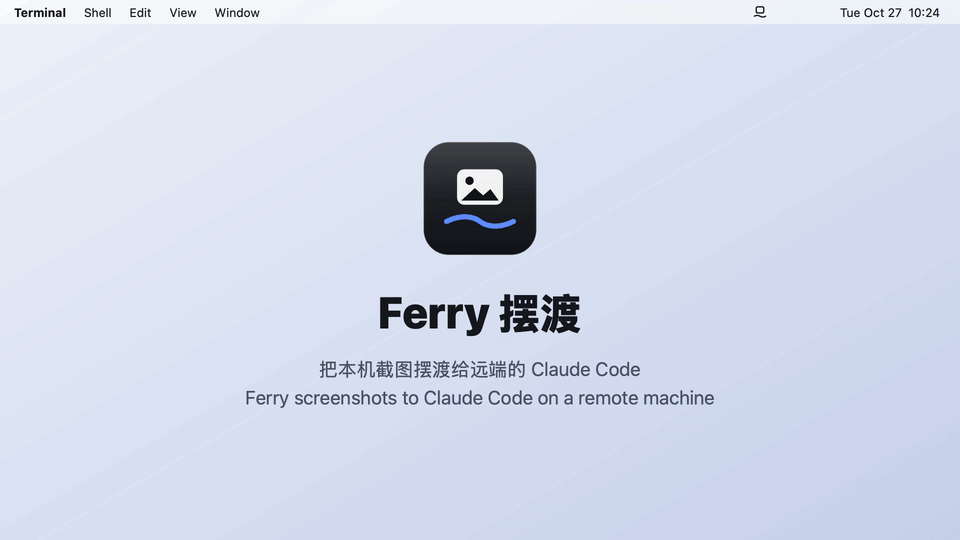
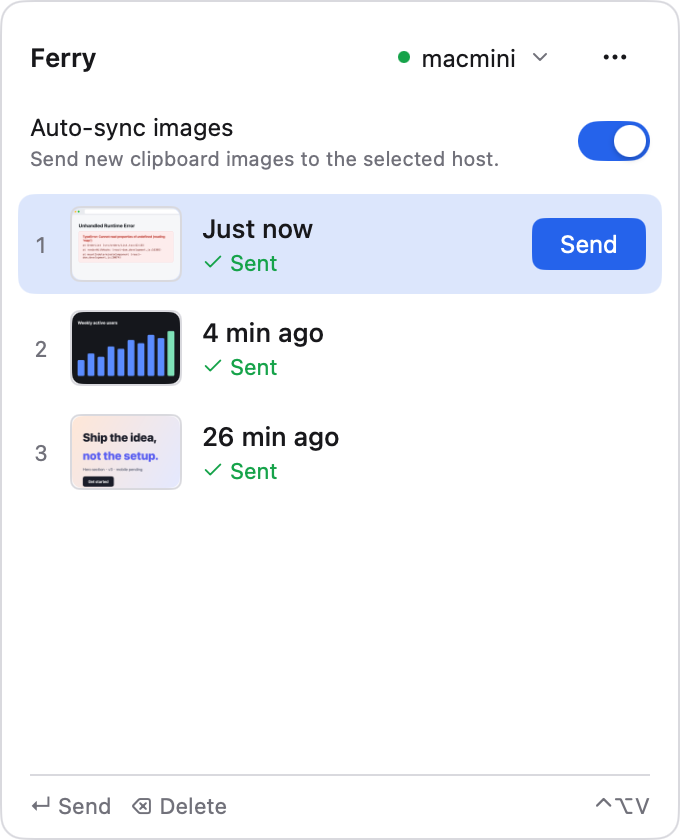
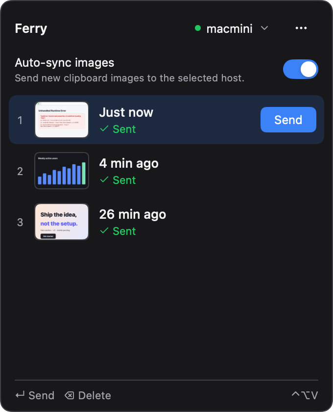
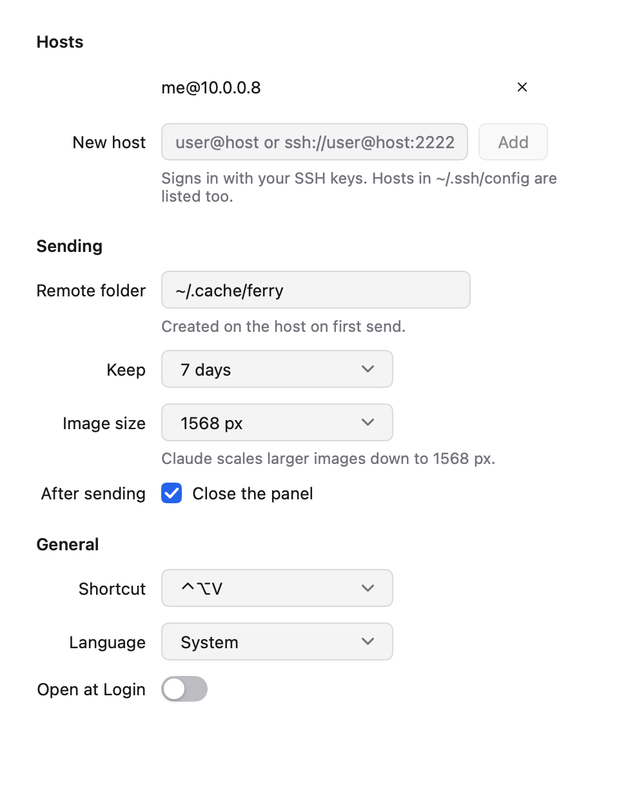

<p align="center">
  
</p>

<h1 align="center">Ferry</h1>

<p align="center">
  Get screenshots from your Mac to Claude Code running on another machine over SSH.
  <br>
  <b>English</b> · <a href="README.zh-CN.md">简体中文</a>
</p>

<p align="center">
  
</p>

When Claude Code runs on a remote machine over SSH, it can't read the screenshot on your Mac. Ferry lives in the menu bar and keeps a history of the images you copy or capture. Press ↵ and it sends that one image to the remote machine over SSH, then copies the image's absolute path on the remote machine. Paste the path into Claude Code and it reads the image.

- **Manual or automatic.** Pick an image to send, or turn on **Auto-sync images** to send new clipboard images to the selected host.
- **Plain SSH.** It uses `/usr/bin/ssh` with your keys, your agent and your `~/.ssh/config`. Nothing needs installing on the remote machine.
- **Fast.** It keeps the connection open after the first send, so later sends skip the handshake. Images are shrunk to 1568 px on the long edge, the largest size Claude reads, and sent as whichever of PNG and JPEG is smaller.
- **Driven from the keyboard.** ⌃⌥V opens the panel. ↑↓ choose an image, ↵ sends it, 1–9 send by position, ⌫ deletes.

<p align="center">
  
  &nbsp;
  
</p>

## Install

Download `ferry-<version>.dmg` from [Releases](../../releases/latest) and drag Ferry to Applications. It's a universal app for Apple silicon and Intel Macs, and needs macOS 12 or later.

The app is signed but not notarized, so macOS blocks it the first time you open it. To let it run, either:

- open **System Settings → Privacy & Security** and click **Open Anyway**, or
- run `xattr -dr com.apple.quarantine /Applications/Ferry.app`.

## Usage

1. Copy an image or take a screenshot. It shows up in Ferry's history.
2. Click the tray icon or press ⌃⌥V, choose a host at the top of the panel, and press ↵.
3. When the panel says **Path copied**, paste the path into Claude Code on the remote machine:

   ```
   > why does this error happen? /home/me/.cache/ferry/5f91392be1766983-1568.png
   ```

Turn on **Auto-sync images** below the host selector to send new copied images and screenshots without opening the panel. It defaults to off and remembers your choice across restarts. Turning it off stops new automatic sends; uploads already in progress finish normally. Successful uploads copy their remote path unless you copied something else in the meantime. Automatic sends leave the panel open.

To send an image again, select it and press ↵, or right-click it to send or delete it. **Settings** and **Clear History** are in the ⋯ menu.

## Hosts

The host menu lists where each host comes from:

- **From ~/.ssh/config**: every concrete `Host` entry in your config, including files pulled in with `Include`. Wildcard entries and Git forges such as github.com are left out.
- **Added**: hosts you add under Settings → Hosts, written as `user@host` or `ssh://user@host:2222`.

Ferry runs ssh in the background (`BatchMode=yes`), so it can't ask for a password. Log in with a key or ssh-agent instead. You can check a host with `ssh <host> true`: if that runs without a prompt, Ferry can use the host. The first time Ferry connects to a host it trusts the host's key (`StrictHostKeyChecking=accept-new`), and it refuses the host if that key later changes.

<p align="center">
  
</p>

## Settings

| Setting | Default | |
| --- | --- | --- |
| Remote folder | `~/.cache/ferry` | Created on the first send. |
| Keep | 7 days | Images older than this are deleted from the remote folder each time you send. |
| Image size | 1568 px | 2560 px or the original are also available. |
| After sending | Close the panel | |
| Shortcut | ⌃⌥V | Also ⌃⇧V, ⌥⇧V or ⌃⌥Space. |
| Language | System | English or 简体中文. |
| Open at Login | Off | |

Ferry keeps the last 100 images in `~/Library/Application Support/Ferry`.

## Build

You need Go 1.27 or later. [MyGo](https://github.com/egoist/mygo) is pinned in `go.mod` and runs through `go tool`.

```sh
go test -p 1 ./...                      # tests
go tool mygo dev                        # run from source
go tool mygo build -skip-notarize       # signed .app and .dmg in build/
```

To sign with your own certificate, set `macos.signingIdentity` in `mygo.json`. Messages live in `locales/`; after editing them, run `go tool mygo generate`.

The screenshots and the demo are drawn from the real views, with no screen needed:

```sh
go run ./tools/rasterize resources/logo.svg resources/icon.png 1024
PROMO_FRAMES=/tmp/frames go test -tags promo -run TestPromo .
ffmpeg -f concat -safe 0 -i /tmp/frames/frames.txt -vf fps=30,format=yuv420p demo.mp4
```

## License

[MIT](LICENSE)
