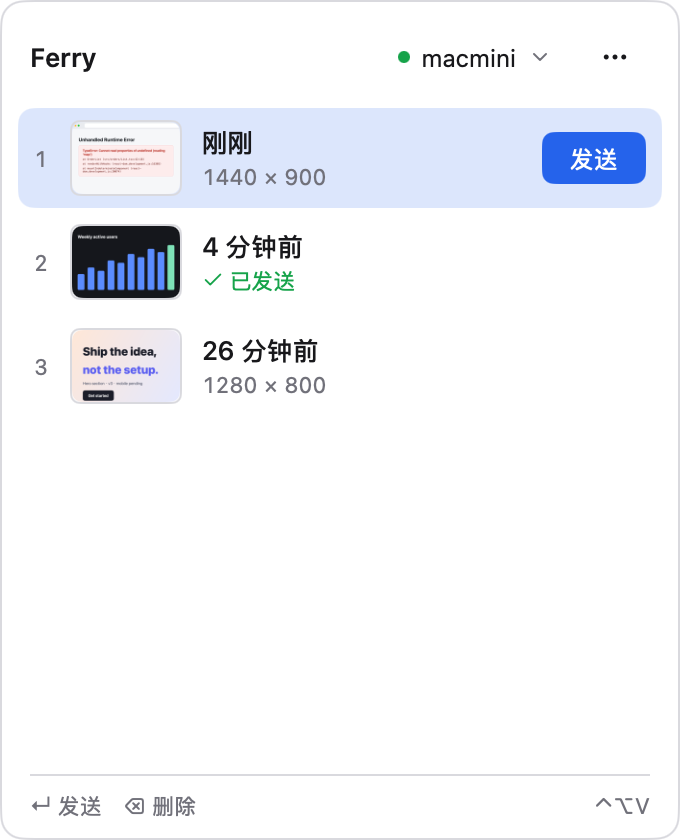
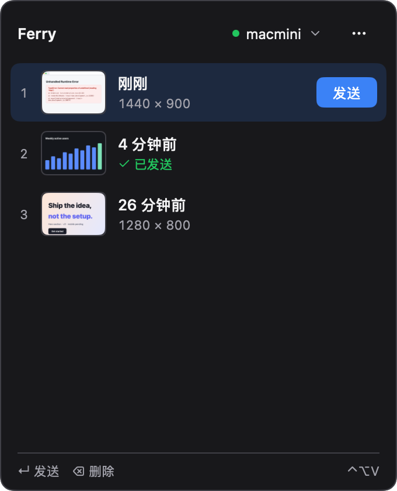
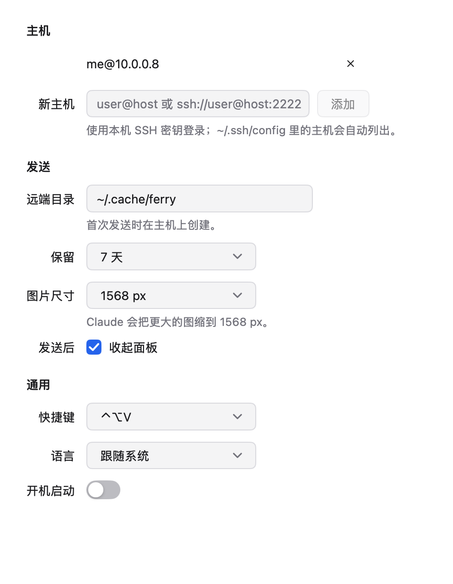

<p align="center">
  
</p>

<h1 align="center">Ferry 摆渡</h1>

<p align="center">
  经 SSH 把 Mac 上的截图送给另一台机器上的 Claude Code。
  <br>
  <a href="README.md">English</a> · <b>简体中文</b>
</p>

<p align="center">
  
</p>

通过 SSH 在远端机器上用 Claude Code 时，它读不到你本机的截图。Ferry 常驻菜单栏，记录你复制或截下的图片。按 ↵ 就把这一张经 SSH 传到远端，并把它在远端的绝对路径放进剪贴板。把路径粘贴给 Claude Code，它就能读到这张图。

- **一次只传一张**：只传你选中的那张图，不同步文件夹，也不依赖局域网共享。
- **只用 SSH**：调用 `/usr/bin/ssh`，沿用你的密钥、ssh-agent 和 `~/.ssh/config`，远端什么都不用装。
- **够快**：首次发送后会保持连接，之后再发不用重新握手。图片长边缩到 1568 px（Claude 能读取的上限），并在 PNG 和 JPEG 里取更小的那个格式发送。
- **键盘操作**：⌃⌥V 呼出面板；↑↓ 选择，↵ 发送，1–9 按序号直接发送，⌫ 删除。

<p align="center">
  
  &nbsp;
  
</p>

## 安装

从 [Releases](../../releases/latest) 下载 `ferry-<版本>.dmg`，把 Ferry 拖进「应用程序」。安装包是通用版本，Apple 芯片和 Intel 的 Mac 都能用，需要 macOS 12 或更新版本。

应用已签名但没有经过 Apple 公证，第一次打开时会被系统拦下。可以任选一种方式放行：

- 打开「系统设置 → 隐私与安全性」，点「仍要打开」；
- 或者在终端里执行 `xattr -dr com.apple.quarantine /Applications/Ferry.app`。

## 使用

1. 复制一张图片或截图，它会出现在 Ferry 的历史里。
2. 点菜单栏图标或按 ⌃⌥V，在面板顶部选好主机，按 ↵。
3. 面板显示「路径已复制」后，把路径粘贴给远端的 Claude Code：

   ```
   > 这个报错怎么修？ /home/me/.cache/ferry/5f91392be1766983-1568.png
   ```

想再发某张图，选中后按 ↵ 即可；右键可以发送或删除。「设置」和「清空历史」在 ⋯ 菜单里。

## 主机

主机菜单会注明每台主机的来源：

- **来自 ~/.ssh/config**：配置文件里所有具体的 `Host` 条目，包括用 `Include` 引入的文件。带通配符的条目和 github.com 这类 Git 托管站会被跳过。
- **手动添加**：在「设置 → 主机」里添加的主机，写成 `user@host` 或 `ssh://user@host:2222`。

Ferry 在后台调用 ssh（`BatchMode=yes`），没法弹出输入密码，所以请用密钥或 ssh-agent 登录。可以先在终端跑一下 `ssh <主机> true`，不用输入任何东西就能执行完的主机，Ferry 就能用。第一次连接某台主机时，Ferry 会自动信任它的密钥（`StrictHostKeyChecking=accept-new`）；之后如果这台主机的密钥变了，Ferry 会拒绝连接。

<p align="center">
  
</p>

## 设置

| 设置项 | 默认值 | 说明 |
| --- | --- | --- |
| 远端目录 | `~/.cache/ferry` | 第一次发送时创建 |
| 保留 | 7 天 | 每次发送时删掉远端目录里超过这个时长的图片 |
| 图片尺寸 | 1568 px | 也可以选 2560 px 或原图 |
| 发送后 | 收起面板 | |
| 快捷键 | ⌃⌥V | 也可以选 ⌃⇧V、⌥⇧V 或 ⌃⌥Space |
| 语言 | 跟随系统 | English 或简体中文 |
| 开机启动 | 关 | |

Ferry 在 `~/Library/Application Support/Ferry` 里保留最近 100 张图片。

## 构建

需要 Go 1.27 或更新版本。[MyGo](https://github.com/egoist/mygo) 的版本已在 `go.mod` 中固定，通过 `go tool` 调用。

```sh
go test -p 1 ./...                      # 测试
go tool mygo dev                        # 从源码运行
go tool mygo build -skip-notarize       # 签名的 .app 和 .dmg 输出到 build/
```

要用自己的证书签名，改 `mygo.json` 里的 `macos.signingIdentity`。文案在 `locales/` 目录，改完后执行 `go tool mygo generate`。

截图和演示视频直接用真实界面渲染，不需要屏幕：

```sh
go run ./tools/rasterize resources/logo.svg resources/icon.png 1024
PROMO_FRAMES=/tmp/frames go test -tags promo -run TestPromo .
ffmpeg -f concat -safe 0 -i /tmp/frames/frames.txt -vf fps=30,format=yuv420p demo.mp4
```

## 许可证

[MIT](LICENSE)
